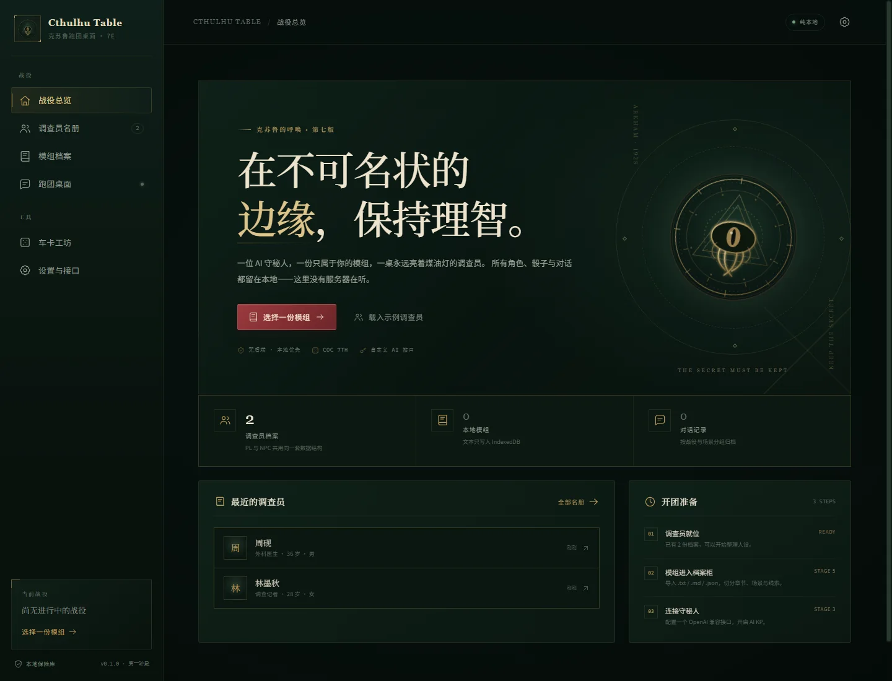

# Cthulhu Table

> 纯前端、零构建、本地优先的《克苏鲁的呼唤》第七版 AI 跑团桌面。  
> 单人 / 多 PL · AI 守秘人 · GitHub Pages 静态托管 · 同人作品

**v1.0.0** · 原生 ES Module + 原生 CSS + localStorage / IndexedDB



---

## 已实现

- **角色卡**：PL / NPC 全字段人设、支持一万字以上的详细角色设定、JSON 导入导出、Markdown 人设卡、档案预览与编辑。
- **CoC 7e 规则引擎**：八属性、年龄修正、HP/MP/SAN/MOV、DB/Build 查表、职业点/兴趣点、信用评级。
- **自动车卡**：10 个内置职业模板、随机骰点、手工分配、LLM 严格 JSON 车卡；AI 技能点从 `EDU×2 / INT×2` 总预算直接分配，不再“先分配再报错”。
- **骰子引擎**：`1d100`、`3d6`、`2d6+6`、`1d8+1d4+2`、`4d6k3`、奖惩骰、六档成功等级、对抗、SAN、伤害、幸运。
- **跑团桌面**：SSE 流式 KP 叙事、待回复队列、KP 统一回复键、下一步提示按钮、POV 检定选项与自动投骰、骰子卡片、暗骰、线索笔记本、剧情进度。
- **API 层**：多套 OpenAI Chat Completions 兼容配置、URL/Key/模型预设库、输入 Key 后检测 `/models`、按服务商分组并按参考价格从低到高排序、自定义 baseURL/请求头/请求体、联网开关、超时与 429/5xx 重试、请求日志。
- **模组**：`.txt / .md / .json` 导入、全文阅读与 AI KP 校订、章节—场景—线索—NPC—事件切分、`HO1/HO2` 身份位解析、场景编辑、关键词倒排索引、TF-IDF 检索。
- **DeepSeek 模组审计**：导入后可选调用 DeepSeek/兼容接口检查切分、关键线索与必须事件；严格 JSON 校验，只接受模组真实存在的标题。
- **KP 严格模组**：系统提示词硬约束、隐藏状态 JSON、状态补丁校验与合并、信息解锁控制。
- **多 PL 视角**：开始战役时选择自己扮演的 PL，其余 PL 交给 AI；支持模组 HO 身份位解析、身份分配与人设叠加。
- **信息隔离**：只向玩家视角角色展示其私密信息；AI 角色的秘密不进入 POV 界面与公开日志，仅用于其自己的代演提示词。
- **角色记忆**：模组完结后由 KP 给出结局，玩家选择“刻录进人设”或“抛弃记忆”；跑团日志始终保留。
- **世界书 / 跑团日志**：每个 KP 回合自动写入日志，配合角色记忆、NPC/地点/线索笔记，支持搜索、编辑与导出。
- **AI 同伴代演**：AI 扮演其余 PL，回复强制 ≤100 字、必须包含行动，并自动选择技能掷骰后交给 KP。
- **存档/归档**：战役快照、完整备份导入导出、角色/聊天/战役/世界书导出、API 日志面板。
- **部署**：`.nojekyll`、GitHub Pages 404 回退、相对路径、移动端适配。
- **站点图标**：原创“守秘人之眼”SVG/PNG/ICO、Apple Touch Icon 与 PWA manifest。

> 详细部署说明见 [docs/deployment.md](docs/deployment.md)。  
> 数据模型见 [docs/data-model.md](docs/data-model.md)。  
> 路线图与验收标准见 [docs/roadmap.md](docs/roadmap.md)。

---

## 快速开始

### 本地预览（推荐）

双击项目根目录的 **`启动本地预览.bat`**，会自动打开：

```text
http://127.0.0.1:8000/
```

脚本使用 Windows 自带的 PowerShell 启动一个只读静态文件服务器，不需要 Node、Python 或后端。

### 任意静态服务器

```bash
python -m http.server 8000
# 或 VS Code Live Server
```

然后访问 `http://127.0.0.1:8000/`。

### 为什么不能直接双击 index.html？

本项目使用**原生 ES Module**。浏览器禁止 `file://` 页面通过 CORS 加载模块文件，因此直接双击会停在启动页。这不是应用 bug，而是浏览器安全策略。项目提供一键本地服务器；部署到 GitHub Pages 后完全正常。

如果必须双击直开，需要额外生成单文件 `standalone.html`（内联所有 JS），会牺牲模块结构；本项目没有采用。

---

## 使用流程

1. **载入或创建调查员**：`/characters` → 新建调查员，或载入示例。
2. **配置接口**：`/settings` → 添加接口或打开「接口预设」→ 选择 DeepSeek → 填 Key → 点「检测模型」→ 选择模型 → 保存配置/保存为预设。可单独指定「模组 AI 检测接口」。
3. **导入模组**：`/modules` → 导入 `.md` / `.txt` / `.json`。可选「阅读 / AI 校订」打开全文阅读与 KP 对话，改完保存或退回；也可快速保存后打开「结构」检查切分、编辑场景、标记关键线索/事件、重新检测。
4. **开始战役**：模组卡片 → 开始战役 → 选择你扮演的 PL，并把模组 HO 身份分配给调查员。例如李四=HO2 长生之人，张三=HO1 将死之人。KP 会自动开场第一幕。
5. **攒一轮行动**：在桌面输入行动按 Enter / 「加入行动」，或用检定选项自动投骰；这些内容先进入「待回复 KP」队列。
6. **统一回复**：可以对同一轮多次投骰、让多个 AI 同伴行动，最后按「回复给 KP」一次性发送。
7. **下一步提示**：KP 回复后，如果生成了提示，会出现「下一步提示」按钮；不按不展开，按了才显示一句话。
8. **AI 同伴**：点击侧栏「张三 · 将死之人 行动」，AI 以张三身份生成 ≤100 字台词/行动并自动掷骰，同样加入待回复队列。
9. **完结模组**：点「完结战役」，KP 严格按模组与已发生事件分配结局；随后选择「刻录进人设」或「抛弃记忆」。
10. **世界书**：`/worldbook` 查看每回合日志、角色记忆与手动设定，可搜索、编辑、删除或导出。
11. **存档/导出**：桌面右上角存档、读档、导出战役；设置页可导出完整备份。

### 桌面命令

| 命令 | 作用 |
| --- | --- |
| `/r 1d100` | 掷骰；支持 `3d6`、`4d6k3`、`1d8+1d4+2` |
| `/c 侦查` | 对你的 POV 角色进行常规检定 |
| `/c 侦查 困难` | 困难检定；也支持 `极难` |
| `/san 1/1d6` | SAN 检定并扣除理智 |
| `/luck 10` | 消耗 10 点幸运 |
| `/opp 侦查 60` | 与技能值 60 的对手对抗 |
| `/help` | 显示命令帮助 |

奖励/惩罚骰、暗骰、技能检定与 SAN 也可以从聊天区按钮直接操作。

### 待回复队列与统一回复

跑团桌面默认采用「攒一轮」模式：

- 输入行动按 Enter / 「加入行动」：只加入待回复队列，不立即请求 KP；
- 技能检定选择 POV 角色的技能后点「自动投骰」：结果自动进入队列；
- AI 同伴行动：自动生成 ≤100 字行动并掷骰，也进入队列；
- 期间可以继续投骰、换行动、让多个 AI 同伴行动；
- 最后按 **「回复给 KP」**，把该轮所有行动与骰子一次性发给 KP；
- KP 只会在按下按钮后统一回复，日志也按这一轮合并记录。

### 下一步提示

KP 回复时会在隐藏状态块里同时返回一条 `nextHint`：

- 有提示时，回复下方出现「下一步提示」按钮；
- 不按按钮时提示不会展开；
- 按下后才显示一句话，例如「检查窗台下的划痕」；
- 没有明确方向时 `nextHint` 为空，按钮不出现。

### 检定选项

聊天区「自动投骰」使用 **POV 角色**的技能列表：

1. 从下拉框选择要过的检定（侦查、聆听、图书馆使用、心理学等）；
2. 选择常规 / 困难 / 极难；
3. 点击「自动投骰」；
4. 结果自动插入骰子卡片并加入待回复队列，不额外调用 AI。

---

## 接口预设与 DeepSeek 模组检测

### 保存接口预设

`设置与接口` → `AI 接口` → `接口预设`：

- 内置 DeepSeek / OpenAI / OpenRouter / 硅基流动的 URL 与模型名；
- 在接口编辑弹窗中点击 **「保存为预设」**，会保存 `name + baseUrl + apiKey + model`；
- 预设库中点击「使用」即可创建一套接口配置；
- 预设与 API Key 都只保存在当前浏览器 localStorage，完整备份会包含它们，请勿提交到公开仓库。

DeepSeek 推荐配置：

```text
Base URL: https://api.deepseek.com/v1
Model:    deepseek-chat
```

### 检测模型、按服务商与价格排序

在接口配置中填入 Base URL 与 API Key 后，点 **「检测模型」**：

- 前端请求 `GET {baseURL}/models`；
- 自动兼容 DeepSeek 等 `/v1/models` 与 `/models` 路径差异；
- 返回模型按服务商分组（DeepSeek / OpenAI / Anthropic / Google / Qwen / …）；
- 同一服务商内按**参考总价（输入 + 输出）从低到高**排序；
- 价格优先使用 `/models` 返回的 pricing（如 OpenRouter），否则使用内置参考价目录；
- 价格未知的模型排在已知价格之后；
- 点击模型即可填入 Model 字段。

价格单位是 **USD / 1M tokens**，仅用于选择时参考，以服务商控制台账单为准。

### 模组导入时调用 DeepSeek 检测

1. 在「设置与接口」的 `模组 AI 检测接口` 中选择一个接口；
2. 导入模组时勾选 `AI 结构检测`；
3. 前端会先本地切分，再把结构 + 文本片段发给所选接口；
4. AI 返回严格 JSON，前端只接受**已有线索/事件/场景标题**：
   - 标记关键线索；
   - 标记必须触发事件；
   - 给出切分建议与警告；
   - 结果写入 `module.aiAudit`，不改写原文；
5. 导入失败/检测失败不会阻止本地保存，可在「结构」中重新检测。

超长模组会按 `maxChars` 截断检测文本，并在结果中标注 `truncated`。

### 导入时阅读全文与 AI KP 校订

导入弹窗底部有两个选择：

- **快速保存**：保留原来的导入流程，可选 AI 结构检测；
- **阅读 / AI 校订**：进入全屏「模组校订台」。

校订台：

1. 左侧是完整模组原文，可滚动阅读，也可以直接编辑；
2. 右侧与 AI KP 对话，例如：
   - “把场景二拆成两个场景”
   - “给 HO1 补一段秘密”
   - “把所有‘调查员’改成‘访客’”
   - “把结局写得更克制”
3. AI 返回**完整修订后的 Markdown**，前端自动重新解析：
   - 章节 / 场景 / 线索 / NPC / HO
   - 分块与检索索引
4. 支持「撤销 AI」「恢复原文」「重新解析」；
5. **HO 补全**：如果原文或对话里出现 `HO1 / HO2 / 身份 / 将死之人 / 长生之人`，但第一次修订没有解析出完整 HO，会自动让 KP 再扫描一次并补出 `# 角色` 段；
6. 解析器不只认标题：
   - `## HO1：将死之人`
   - `HO1：将死之人`
   - `**HO2 长生之人**`
   - `- HO1 将死之人`
   
   都能识别；
7. 底部选择：
   - **保存模组**：写入档案柜；
   - **退回不保存**：关闭校订台，档案柜保持原样。

AI 校订有单次 40,000 字原文上限；超长模组建议直接手动编辑左侧原文，或先在外部拆分。

相关文件：[module-view.js](cthulhu-table/js/views/module-view.js)、[module-editor.js](cthulhu-table/js/module-editor.js)。

---

## 角色扮演、记忆与世界书

### 详细角色设定

调查员编辑页新增「详细角色设定」字段，不设前端字数上限，可写一万字以上；保存后会用于：

- AI 同伴代演的角色语气、价值观、秘密与行动倾向；
- KP 上下文中的角色扮演摘要；
- AI 车卡时的参考人设。

### AI 按总预算车卡

「按人设自动车卡」不再要求模型先算对点数再通过校验，而是：

1. 模型先给出年龄修正前的属性与技能倾向；
2. 程序应用年龄修正，计算：
   - 职业点总预算 = 最终 EDU × 2
   - 兴趣点总预算 = 最终 INT × 2
3. `skills[].occupation` / `skills[].interest` 作为目标点数/权重；
4. 程序从总预算出发精确分配：
   - 优先保留 AI 的目标点数；
   - 不足部分均匀补齐；
   - 超额部分自动缩放；
   - 单技能总计不超过 99；
   - 信用评级强制预留职业点；
5. 不再因为模型少算/多算几点就整份重试。

AI 车卡完成后，状态栏会显示类似：

```text
职业点 160/160，兴趣点 140/140，已按总预算精确分配。
```

### 多 PL 视角与 HO 身份

开始战役时会打开「选择视角与身份」：

- 选择一个你亲自扮演的 PL；
- 其余 PL 全部由 AI 扮演；
- 模组中的 `HO1：将死之人`、`HO2：长生之人` 等标题会自动解析为 HO 身份位；
- 每个 HO 可分配给一位调查员，必须唯一；你的角色必须获得一个 HO；
- 分配后，HO 的 `人设` 会叠加到该角色在本场战役中的有效设定，`公开信息` 可进入公共叙事，`秘密` 只进入对应角色的上下文。

示例：

```text
你扮演：李四
HO1 将死之人 → 张三（AI）
HO2 长生之人 → 李四（你）
```

KP 自动开场第一幕，不需要手动输入开场指令。

### 信息隔离

- 只有你的 POV 角色能看到自己的「你的私密信息」面板；
- AI 角色的 `privateNotes` 不渲染在页面上，也不写入公开世界书日志；
- KP 的系统提示词只注入 POV 的私密信息，并明确要求不能泄露其他角色的秘密；
- AI 同伴代演时，其私密信息只进入它自己的提示词，并且被要求只能通过行动、停顿、回避或暗示表现，不能直接说破；
- 结局只从 POV 视角收束，不公开其他角色的内心秘密。

### AI 同伴：≤100 字 + 必须行动 + 自动骰子

跑团桌面左侧会列出 AI 同伴，每个角色都有「行动」按钮：

1. 读取该角色的详细设定、HO 人设、跨模组记忆、世界书与最近对话；
2. 生成角色台词/行动，**超过 100 字会自动重试**；
3. 必须返回具体行动与一个角色技能；
4. 前端调用 CoC 检定自动掷骰，插入骰子卡片；
5. 把「角色行动 + 骰子结果」交给 KP 继续叙事。

AI 不替 KP 宣布结果，也不控制你的 POV 角色；最终成败仍由骰子与 KP 判定。

### 结局与记忆选择

桌面右上角「完结战役」：

1. KP 读取模组章节大纲、已发现线索、已触发事件、KP 状态、聊天记录与 POV 私密信息；
2. 按模组已写明的结局/失败条件分配结局，输出 `endingTitle`、`endingText`、`povFate`；
3. 弹出结局后，玩家自行选择：
   - **将记忆刻录进人设**：写入 `character.memories` 与世界书 `type: "memory"`；
   - **抛弃记忆，保留日志**：不写入角色记忆，但本场跑团日志继续保留；
4. 下一次选择同一调查员开始新模组时，已刻录的记忆自动进入 KP 与 AI 同伴上下文；
5. 接口不可用时使用 KP 状态生成本地兜底结局。

### 跑团日志与世界书

- 每个 KP 回合结束后，自动把「玩家行动 + 骰子 + KP 叙事」写入世界书 `type: "log"`；
- `/worldbook` 可按角色记忆、跑团日志、世界设定分组查看；
- 支持搜索、编辑、删除、手动新建 NPC/地点/线索/笔记；
- KP 会检索与当前场景最相关的世界书条目，避免跨模组失忆；
- 完整备份与单战役导出都包含世界书。

---

## 文件树

```text
cthulhu-table/
├── index.html                    应用外壳、启动页、图标 sprite、dialog/toast 容器
├── 404.html                      GitHub Pages 404 回退（自动回到 #/home）
├── .nojekyll                     禁用 GitHub Pages 的 Jekyll 处理
├── css/
│   └── main.css                  设计系统、布局、车卡/桌面/设置全部样式
├── js/
│   ├── app.js                    Hash 路由、应用外壳、全局动作分发
│   ├── storage.js                localStorage + IndexedDB、战役、备份、日志
│   ├── ui.js                     HTML 转义、Toast、Dialog、下载、格式化
│   ├── dice.js                   骰子解析、CoC 检定、SAN、伤害
│   ├── dice.test.js              30+ 条 console.assert 单元测试
│   ├── character.js              CoC 规则引擎、职业模板、AI 车卡提示词与总预算分配
│   ├── api.js                    OpenAI 兼容接口、/models、SSE、重试、联网、日志
│   ├── model-catalog.js          模型服务商归组与参考价格排序
│   ├── module.js                 模组解析、分块、倒排索引、TF-IDF 检索
│   ├── module-audit.js           DeepSeek/兼容接口的模组结构审计
│   ├── module-editor.js          导入时的全文阅读、AI KP 校订与撤回
│   ├── actor.js                  AI 同伴：≤100字、行动约束、技能选择
│   ├── ending.js                 模组结局、POV 记忆与严格模组收束
│   ├── memory.js                 角色记忆结构与世界书条目
│   ├── kp.js                     KP 提示词、状态机、上下文组装、信息释放
│   ├── sample-data.js            示例调查员
│   └── views/
│       ├── home-view.js          战役总览
│       ├── character-view.js     名册与车卡工作台
│       ├── module-view.js        模组档案与结构编辑
│       ├── table-view.js         跑团桌面、AI 同伴、POV、完结战役
│       ├── worldbook-view.js     世界书、跑团日志与角色记忆
│       └── settings-view.js      接口、KP 参数、存储、日志
├── assets/
│   ├── sigil.svg                 原创旧日印记（启动页/侧栏品牌）
│   └── icons/
│       ├── icon.svg              App 图标源文件（512）
│       ├── favicon.svg           小尺寸简化图标
│       ├── icon-16/32/48.png     浏览器标签页与 ICO 源
│       ├── icon-180.png          Apple Touch Icon
│       └── icon-192/512.png      PWA 安装图标
├── favicon.ico                   传统浏览器 favicon
├── site.webmanifest              PWA 图标与安装信息
├── schemas/
│   ├── character.schema.json
│   ├── module.schema.json
│   ├── session.schema.json
│   ├── settings.schema.json
│   ├── worldbook.schema.json
│   └── chat.schema.json
├── docs/
│   ├── data-model.md
│   ├── roadmap.md
│   ├── deployment.md
│   └── preview-home.webp
├── serve.ps1                     零依赖 PowerShell 静态服务器
├── 启动本地预览.bat              一键启动
└── README.md
```

---

## 测试

### 骰子单元测试

设置页 → 「骰子自检」，或在控制台：

```js
const { runDiceTests } = await import('./js/dice.test.js');
runDiceTests();
```

覆盖：表达式、保留最高/最低、运算符优先级、00+0=100、奖励/惩罚骰、六档成功等级、大失败阈值、难度门槛、对抗、SAN、伤害、幸运、非法表达式。

### 手工回归清单

- [x] 桌面 1440px / 移动 390px，无横向溢出
- [x] 七个页面路由与深链接刷新（含世界书）
- [x] 示例角色载入、编辑、保存、JSON 导出
- [x] 模组导入、检索、战役创建
- [x] 接口预设保存 / 复用（URL、Key、模型名）
- [x] `/models` 检测、按服务商分组、组内参考价格升序
- [x] DeepSeek 模组审计：JSON 校验、标题白名单、关键线索/事件标记
- [x] 导入模组全文阅读、AI KP 校订、撤销/恢复、保存/退回
- [x] HO 缺失时 AI 二次补全；普通行/列表/加粗 HO 也能解析
- [x] 行动/骰子进入待回复队列；KP 只在「回复给 KP」后统一回复
- [x] 下一步提示按钮：有提示才出现，按下才展开一句话
- [x] POV 检定选项 + 自动投骰 + 结果入队
- [x] 详细角色设定 15000 字保存、回显与 AI 上下文
- [x] AI 车卡按 EDU×2 / INT×2 总预算分配，少点/超点/空技能均可用
- [x] HO1/HO2 身份解析、POV 选择、唯一身份分配、人设叠加
- [x] POV 界面只显示自己的私密信息；AI 秘密不进入公开 DOM/日志
- [x] AI 同伴：≤100 字校验、行动、技能选择、自动检定
- [x] KP 自动开场第一幕
- [x] 每回合日志写入世界书；世界书搜索/编辑/删除
- [x] 完结战役生成结局；刻录/抛弃记忆二选一；日志始终保留
- [x] 骰子卡片、暗骰、SAN 扣除
- [x] 多接口配置、SSE 流式、超时与 429/5xx 重试
- [x] KP 状态块解析、合并、信息解锁
- [x] 战役存档/读档、完整备份导出
- [x] 无未捕获异常

---

## 数据与隐私

- **没有后端。** 没有账号、统计或云端同步。
- 设置、角色、战役与 API Key 存 `localStorage`；模组、聊天、存档、日志存 `IndexedDB`。
- API Key 只通过前端 `fetch` 发送到**你填写的接口地址**，不会上传到本项目。
- 完整备份包含 API Key；请勿提交到公开仓库。
- 清除浏览器站点数据会丢失全部战役，请定期导出备份。

---

## 规则与版权

- 规则口径：*Call of Cthulhu 7th Edition* 核心规则书。
- 车卡公式、年龄修正、DB/Build 查表、检定等级均在代码中注明规则出处。
- 本工具为非官方同人作品，与 Chaosium Inc. 无隶属关系。
- 请只导入你拥有使用权的模组文本。

---

## 已知边界

- 模组自动切分是启发式初稿；支持编辑场景内容和标记，但复杂排版仍建议先整理 Markdown 标题。
- AI 模组审计只提供结构与标记建议，不会改写原文；超长模组只审计前 `maxChars` 段，并在结果中标注截断。
- 模型价格来自内置参考目录或接口返回值，可能随服务商调价而过时；排序只作选择参考。
- KP 的“严格遵循模组”依赖系统提示词与检索上下文，不能数学证明模型永不越界；前端会限制未解锁内容进入提示词，并校验状态补丁。
- 多 PL 目前是同一浏览器中的多角色桌面，不是联机同步房间。
- AI 自动车卡与守秘人需要可用的 OpenAI Chat Completions 兼容接口。
